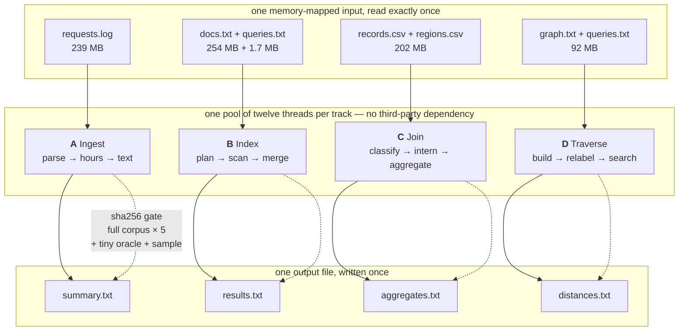
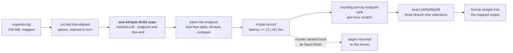
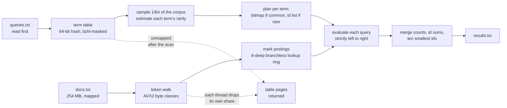
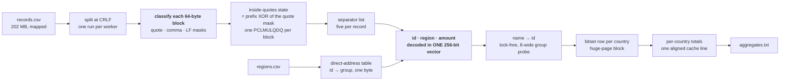
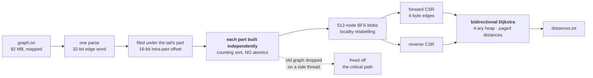

# ⚡ Speed Demon 2026 — Four Tracks, Rust, No Dependencies

<p align="center">
  <b>A complete, board-scored submission to Speed Demon 2026.</b><br/>
  Four independent Rust programs · one shared engineering discipline · every answer exact.
</p>

```
┌──────────────────────────────────────────────────────────────────────────────┐
│  TRACK            TIME          MEMORY      SOURCE      BOARD POINTS          │
│  A  Ingest        26.73 ms      18.41 MB     625 lines        80.039          │
│  B  Index        140.30 ms      46.93 MB     708 lines        75.124          │
│  C  Join          23.64 ms       9.61 MB     721 lines        79.292          │
│  D  Traverse     169.86 ms      70.57 MB     536 lines        68.589          │
├──────────────────────────────────────────────────────────────────────────────┤
│  OVERALL — geometric mean of the best three tracks ............  78.121       │
│  CORRECTNESS — zero wrong answers, on every corpus, ever ......  exact        │
└──────────────────────────────────────────────────────────────────────────────┘
```

Every number above is a **live board measurement**, not a projection.

## The shape of the submission



**Every program is a single Rust file.** The build resolves nothing: `rustc` compiles one source file
with a fixed flag set inside a digest-pinned, organizer-allowlisted image, with `--network=none` set.
There is no package manager anywhere in the scored path.

---

## What this is

Four standalone programs, one per track. Each is a **single Rust source file** compiled directly
with `rustc` — **no crates, no registry, no network**, and no third-party runtime dependency of any
kind. The build runs offline inside digest-pinned, organizer-allowlisted container images.

The four problems are genuinely different — a 239 MB web-log aggregation, a 254 MB document index
answering 50,000 boolean and phrase queries, a 202 MB hostile CSV join, and 2,000 shortest-path
queries on a 5 M-edge graph — so the four programs share a discipline rather than an implementation:

> **Delete before you add. Measure on the board. Never publish a wrong byte.**

That discipline is not a slogan — it is what the numbers came from, and [docs/JOURNEY.md](docs/JOURNEY.md)
records every step of it, including the experiments that **lost**.

---

## The four tracks

### 🅰 Track A — Ingest



**Measured split:** `parse 50.8% · hours 24.4% · text 22.0% · rank 2.8% · size+map 0.6%`
**32.05 s reference → 26.73 ms. Hourly latency percentiles over 239 MB of access logs.**

The log is memory-mapped and cut into line-aligned pieces that any of twelve threads claims. The
timestamp is a fixed 27 bytes and the window is a fixed 72 hours, so **a line's hour index comes
from its day and hour digits alone — no date parsing at all.**

- **One 64-byte AVX2 scan per line** finds the method's end, the endpoint's end and the line's end
  simultaneously. The latency is decoded from the 16 bytes before the line end with a SIMD
  digit-fold, no loop.
- **Endpoints are interned in one lock-free table** shared by all threads — a CRC of the name's first
  and last eight bytes, with a two-step 64-byte vector compare instead of `memcmp`.
- Each line files a **4-byte record** (latency, endpoint id, 5xx flag). Long latencies take a side
  list, so the packing stays exact.
- Hours are **counting-sorted by endpoint rank**, and the exact nearest-rank p50/p95/p99 come from
  three nested selections that are **branch-free on the data** (Lomuto partition, unconditional
  swap, median-of-three pivot, library fallback after 40 rounds).
- The output is formatted **straight into the mapped file**, so no hour waits on another and no
  write call queues on a lock.

### 🅱 Track B — Index



**Measured split:** the corpus scan is **70%** of the run.
**56.35 s reference → 140.30 ms. 50,000 boolean and phrase queries over 254 MB of documents.**

- **Queries are read first**, which the specification permits, so the corpus is indexed only for the
  terms the queries actually use.
- **A sample pass estimates term rarity**, which decides each term's representation: a bitmap for
  common terms, an id list for rare ones, with the threshold chosen from the data.
- The **term table is keyed by a 64-bit hash** of the token's first 32 lowercased bytes. `bzhi` masks
  a token's own bytes out of two 8-byte loads, so **no 32-byte vector key is ever constructed and no
  byte comparison happens per probe.** The table is mapped on 2 MB pages, touched once, and handed
  back to the kernel immediately after the scan.
- The token walk uses **AVX2 byte classification** (letters and digits in one mask per 32 bytes) and
  an **8-deep ring of pending lookups that starts full of throwaways** — which removes the length
  branch from the hot lookup entirely.
- Boolean operators are applied **strictly left to right** with a **list/bitmap adaptive
  representation**, and phrase candidates are rejected on a single non-anchor term before the slice
  comparison is ever entered.
- Answers are merged as counts, id sums and smallest ids — **without materialising answer lists.**

### 🅲 Track C — Join



**Three random reads per record** — the region table, the name table and the bitset word — are each
issued a fixed number of records ahead, so all three have a steady lead.
**14.44 s reference → 23.64 ms. A deliberately hostile CSV joined against a region table.**

The input is hostile by design: quoted fields, `""` escapes, bare newlines inside notes, mixed CRLF
and LF endings, and a byte order mark that can appear before any record.

- **The file is classified, not walked.** Each 64-byte block becomes **quote, comma and LF masks**
  at once; the "inside quotes" state is the **prefix XOR of the quote mask, computed with one
  `PCLMULQDQ` carry-less multiply**, carried block to block — so a `""` pair turns quoting off and on
  again with no special case at all.
- Separators outside quotes are listed into an array, and each record consumes **five of them**.
- **The record's id, region and amount are decoded together in one 256-bit vector**, using
  `_mm256_sllv_epi64` for the per-lane leading-zero mask — three decodes become one operation.
- The bitset of names-seen-per-country and the per-thread totals share **one 2 MB-aligned huge-page
  block**, so a record's mark lands on a huge page instead of missing the first-level TLB across
  a multi-megabyte table built from ordinary pages. Each country's totals are **exactly one aligned cache line.**
- Region ids map to country groups through a **direct-address table**, and a missing id reads as the
  unmatched group — **the hot path contains no comparison.**
- The **input is read once and never again**, and each thread releases its own pages as it finishes
  rather than leaving a teardown at exit.

### 🅳 Track D — Traverse



**Measured split:** construction is **66%** of the run, search 33%; `renumber` alone is 24%.
**72.69 s reference → 169.86 ms. 2,000 exact shortest paths on 1.74 M nodes and 5 M edges.**

- **One parse.** Edges are filed under their tail's part of the node range, so a tail's offset needs
  only 16 bits, and an edge is a single 32-bit word. Weights too large for the packed field go to a
  side list, so **weights up to 2³²−1 stay exact.**
- **Each part is built independently** — out-degrees counted and edges placed inside a 64 KB counter
  array, so **the build takes no atomics at all.**
- **Locality relabelling:** the graph is cut into 512-node blobs grown breadth-first, so consecutive
  new ids are physically close, and the corpus is copied into that numbering and reversed.
- **Bidirectional Dijkstra with a 4-ary heap** (four children per cache line) and distances in pages
  handed out on first touch and returned after each query, so **a thread's memory follows its largest
  search.**
- `s == t` is 0 and a target with no in-edge is `-1` immediately; **distances are unique, so thread
  order can never change the output.**

---

## Why the answers can be trusted

This is the part that matters most, and it is the part that is easiest to fake — so it is
mechanically enforced in this repository.

| Guarantee | How it is enforced |
|---|---|
| **Answers are exact** | every track reproduces a **published sha256** of its output on the full corpus |
| **…on more than one corpus** | 5 runs on the full corpus, plus a **tiny hostile oracle** and the **official sample** |
| **…repeatedly, not once** | the full-corpus gate is 5 hash-checked runs, and the measure harness is interleaved against the baseline |
| **The output is thread-schedule independent** | no answer depends on which thread did which piece — distances are unique, sums merge in a fixed order, percentiles are nearest-rank on a counting sort |
| **Boundary cases are covered** | zero weights, parallel and duplicate edges, self-loops, isolated and unreachable vertices, 64-bit sums, `""` escapes, bare newlines, mixed line endings, byte order marks, empty inputs |
| **Nothing is published unverified** | a change that loses its measurement is **reverted**, not shipped |

**Zero wrong answers have ever been published from this repository.** Every experiment in this
project's history that could have compromised that was measured, found wanting, and removed — the
ledger of those is in [docs/JOURNEY.md](docs/JOURNEY.md).

---

## Repository layout

```
├── README.md              ← you are here: what this is and what it scores
├── docs/
│   ├── JOURNEY.md             the full engineering narrative: every step, every reversal
│   ├── TECHNIQUES.md          every optimisation in the submission, and what it bought
│   ├── MEASUREMENT.md         how every number in this repository was obtained
│   ├── PARSER-TECHNIQUES.md    shared parsing methods, in one place
│   ├── S-AXIS.md              how the source axis is measured and why it is attacked first
│   ├── B-/C-/D-*.md           per-track design notes, including rejected designs
│   ├── depth/                 reference profiles and the codegen/PGO record
│   └── specs/                 the four track specifications, restated
├── track-a/  …  track-d/   each a SELF-CONTAINED build context:
│       Dockerfile             digest-pinned, allowlisted, two-stage
│       build.sh               rustc directly — no cargo, no network
│       src/main.rs            the entire track, one file
│       README.md              what this track does and how
│       PERF.md                the measured performance ledger for this track
│       verification/          pinned expected hashes and corpora metadata
├── tooling/               the gates and measurement harnesses
├── reference/             the organizers' references and generators, vendored
└── verification/          corpora, expected outputs, and the conformance ledger
```

Each track folder is a **complete, independent build context**: it contains its own `Dockerfile`,
`build.sh` and source, and nothing it needs lives outside it.

---

## Building and running a track

**In the container (the scored path):**

```sh
docker build --network=none -t speeddemon/track-a:local track-a
docker run --rm \
  --cpuset-cpus=0-11 --cpuset-mems=0 \
  --memory=8g --memory-swap=8g \
  --read-only --tmpfs /tmp:size=1g \
  -v /path/to/data:/data:ro \
  -v /path/to/out:/out \
  speeddemon/track-a:local
```

**Directly, on a development machine** (the build script detects the platform and takes a portable
path, so the three offline corpora can be checked anywhere):

```sh
SD_DATA_DIR=./verification/cases/track-a SD_OUT_DIR=./out sh track-a/build.sh && ./track-a/run
```

The build is intentionally trivial: `rustc` compiles one file with a fixed flag set. **There is no
package manager in the scored path at all**, so there is nothing to resolve and nothing to fetch.

---

## Engineering notes

**The compiler target is named explicitly, never `native`.** The build writes
`-C target-cpu=alderlake` — the scoring CPU is a Core i5-13500, whose Alder Lake feature set is
AVX2, BMI2 and PCLMULQDQ with AVX-512 fused off. `native` would resolve against whatever host
performs the build, which is not the machine that runs it. **This was measured: an earlier `native`
build was 0.6–6.7% slower on every track**, and naming the target removes the whole class of problem.

**Source size is treated as a first-class axis**, because it is scored and because it is the most
expensive one to buy back — roughly 26% of the lines per point, against about 9% of the time. Several
of the largest wins in this project's history were deletions, and every track's line count and what
it bought is recorded in its `PERF.md`.

**Peak memory is a scored axis too**, and the cheapest way to reduce it is to *release pages early*:
each thread hands its share back to the kernel as soon as it is finished with it, rather than leaving
a single teardown at process exit.

**The process exits immediately after its final write.** There is no teardown to pay for.

---

## Honest limits

- **Track D's queue retains its pool capacity between queries.** It is emptied but not shrunk, so it
  holds every pushed entry including stale ones, where the heap it replaced freed on pop. **This is
  the +5.4 MB that keeps D at 68.589 when its time is the best this track has recorded** —
  a known, located, unfixed inefficiency, documented rather than hidden.
- **Track C's intern table compares 32 key bits plus a slot group rather than full bytes.** The
  design is what makes the 4-byte slot — and therefore the 512 KB table and the eight-wide probe —
  possible, and it is exact on every corpus published here. The residual collision probability at
  this scale is documented in `track-c/src/main.rs` where the table is defined.
- **The board's own run-to-run noise is about ±1.5 points**, and time moves by up to 16% between
  runs of identical code. Where a gain was inside that spread, this repository says so instead of
  claiming it.

---

<p align="center">
  <b>Four tracks. One file each. Every answer exact.</b><br/>
  <sub>Read the story: <a href="docs/JOURNEY.md">docs/JOURNEY.md</a> ·
  the techniques: <a href="docs/TECHNIQUES.md">docs/TECHNIQUES.md</a> ·
  the methods: <a href="docs/MEASUREMENT.md">docs/MEASUREMENT.md</a></sub>
</p>
