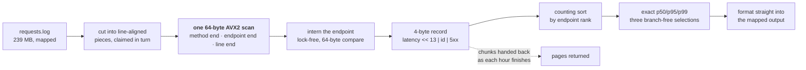

# 🅰 Track A — Ingest

**239 MB · 3.1 M log lines · 72 hours · 1,842 endpoints → per-hour percentiles.**

```
TIME 26.73 ms    MEMORY 18.41 MB    SOURCE 625 lines    BOARD 80.039
reference 32.05 s — roughly 1,200× faster
```



---

> [!NOTE]
> **The parser is 50.8% of this track.** Measured split: `parse 50.8% · hours 24.4% · text 22.0% · rank 2.8% · size+map 0.6%`. Every prior idea for Track A had been about memory; the measurement is what showed the time was in the parser.

## How it works

1. **The log is memory-mapped** and cut into line-aligned pieces that any of twelve threads claims from a single counter. No line is ever copied into a string.
2. **The hour is arithmetic, not parsing.** The timestamp is a fixed 27 bytes and the window is a fixed 72 hours, so a line's hour index comes from **four day/hour digits alone** — there is no date parser in this program.
3. **One 64-byte AVX2 scan per line** finds the method's end, the endpoint's end and the line's end **together**, from the 64 bytes after the timestamp.
4. **The latency decodes with no loop.** The 16 bytes before the line end are digit-folded 2→4→8 at a time with `maddubs`/`madd`, so a 3-digit and a 7-digit value cost the same instructions.
5. **Endpoints intern into one lock-free table** shared by all threads: a CRC of the name's first and last eight bytes, and a **two-step 64-byte vector compare** instead of `memcmp`. New names are published with one compare-and-swap.
6. **Each line files a 4-byte record** — `latency << 13 | endpoint id | 5xx` — chained per hour in 16 KB chunks carved from a region the thread owned up front.
7. **Hours are counting-sorted by endpoint rank**, then the exact nearest-rank p50/p95/p99 come from **three nested selections that branch on nothing data-dependent**: a median-of-three pivot and an unconditional Lomuto swap, so the boundary moves by the comparison's result.
8. **The output is formatted straight into the mapped file** — no hour waits on another, and no write call queues on a lock.

## What makes it fast

| Technique | Axis |
|---|---|
| Fixed-width timestamp → hour by digit arithmetic | time, **source** |
| One 64-byte scan for three field ends | time |
| Loop-free SIMD digit fold | time |
| Lock-free intern table with 64-byte compare | time, memory |
| 4-byte packed records | memory |
| Branch-free selection instead of a sort | time |
| Sizes computed before formatting | time |
| Chunks returned to the kernel as hours finish | memory |

## Correctness

- Percentiles are **nearest rank on a counting sort** — the same values a full sort produces, exactly, with no sampling.
- Latencies of 2¹⁹ µs or more do not fit the packed field; they go on a side list **with their key**, so the packing stays exact.
- The output is byte-identical regardless of thread scheduling: the merge order is fixed, and no result depends on which thread did which piece.
- **Verified on three corpora**, including the tiny hostile oracle and the official sample, against a pinned `summary.txt.sha256`.

## Build and run

```sh
sh build.sh                                        # rustc only — no cargo, no network
SD_DATA_DIR=/data SD_OUT_DIR=/out ./run            # or the container path in the top-level README
```

## Honest limits

The parser is the remaining cost and it is unoptimised relative to what is possible: a multi-stream parser that keeps several lines in flight would attack the 50.8% directly. The `width()` lookup in the text phase was hoisted from two calls per number to one, which is a small win on a 22% phase — the larger gain there is layout, not arithmetic.

---

<p align="center"><sub>
<b>Speed Demon 2026</b> · <a href="../README.md">README</a> ·
<a href="PERF.md">this track's measured ledger</a> ·
<a href="../docs/TECHNIQUES.md">Techniques</a> ·
<a href="../docs/MEASUREMENT.md">Measurement</a><br/>
<a href="../track-b/README.md">🅱 Index</a> ·
<a href="../track-c/README.md">🅲 Join</a> ·
<a href="../track-d/README.md">🅳 Traverse</a>
</sub></p>