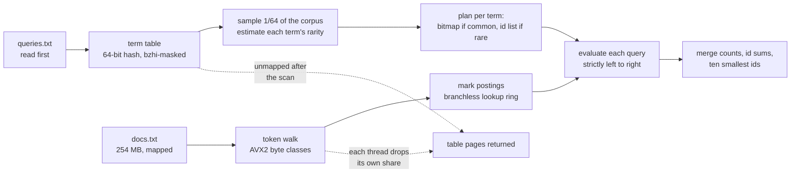

# 🅱 Track B — Index

**254 MB of documents · 50,000 boolean and phrase queries → count, id sum, ten smallest ids.**

```
TIME 140.30 ms    MEMORY 46.93 MB    SOURCE 708 lines    BOARD 75.124
reference 56.35 s — roughly 400× faster
```



---

> [!NOTE]
> **The corpus scan is 70% of this track.** That is why the index is built only for terms the queries mention, and why the term lookup itself was made branchless and keyless.

## How it works

1. **Queries are read first**, which the specification permits — so **no posting list is ever written for a term no query mentions.** Most of the corpus's tokens are query terms; the rest cost one hash lookup and nothing more.
2. **A sample pass over the first 1/64 of the corpus** estimates how many documents hold each term. That decides each term's representation: **a bitmap for terms in many documents, an id list for terms in few.** The threshold comes from the data, not a constant.
3. **The term table is keyed by a 64-bit hash** of the token's first 32 lowercased bytes. `bzhi` masks a token's own bytes out of two 8-byte loads, so **no 32-byte vector key is ever built and no byte comparison happens per probe.** Four slots share an aligned group, and one 32-byte compare finds either the term or the first free slot.
4. **The token walk classifies 32 bytes at a time** — letters (case-folded with one `or`) and digits in a single mask — so token boundaries fall out of one comparison per half-line.
5. **The lookup ring is eight entries deep and starts full of throwaways**, so a lookup is always issued for a full slot and the caller simply skips the first eight ids. **That removes the length branch from the hot loop entirely.**
6. **Boolean operators apply strictly left to right**, switching between id lists and bitmaps based on operand size.
7. **Phrase candidates are rejected on one non-anchor term first**, so most windows never reach the slice comparison.
8. **Results merge as counts, id sums and smallest ids** — the answer lists themselves are never materialised.

## What makes it fast

| Technique | Axis |
|---|---|
| Queries first — index only queried terms | time, memory |
| Sample-driven bitmap/list choice per term | time, memory |
| `bzhi`-masked 64-bit token hash | time, **source** |
| Term table on 2 MB pages, unmapped after the scan | time, memory |
| Branchless 8-deep lookup ring | time, **source** |
| AVX2 letter/digit classification | time |
| Adaptive list/bitmap boolean evaluation | time |
| Single-term phrase rejection | time |
| Counts without materialising answers | time, memory |

## Correctness

- The scan is a single forward pass over disjoint document ranges; each thread marks its own region of the bitmap, so no two threads write the same word without an atomic.
- Phrase matching requires **exact adjacency** in the token stream, anchored on the rarest term and verified against the same exact lookups.
- Sampling only decides **how much work to do** — it never decides an answer.
- **Verified on three corpora**, including the tiny hostile oracle and the official sample, against a pinned `results.txt.sha256`.

## Build and run

```sh
sh build.sh                                        # rustc only — no cargo, no network
SD_DATA_DIR=/data SD_OUT_DIR=/out ./run            # or the container path in the top-level README
```

## Honest limits

Term identity is the **top 46 bits of a 64-bit hash** rather than a byte comparison — exact in practice at this vocabulary, but no longer exact by construction, and the published hash on three corpora is what checks it. The table is sized from the query file with a bound that fails loudly rather than spinning, since both the probe and the insert loop stop only at a free slot.

---

<p align="center"><sub>
<b>Speed Demon 2026</b> · <a href="../README.md">README</a> ·
<a href="PERF.md">this track's measured ledger</a> ·
<a href="../docs/TECHNIQUES.md">Techniques</a> ·
<a href="../docs/MEASUREMENT.md">Measurement</a><br/>
<a href="../track-a/README.md">🅰 Ingest</a> ·
<a href="../track-c/README.md">🅲 Join</a> ·
<a href="../track-d/README.md">🅳 Traverse</a>
</sub></p>