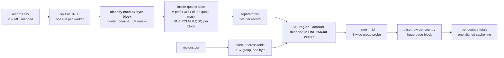

# 🅲 Track C — Join

**202 MB hostile CSV joined against a region table → one line of aggregates per country.**

```
TIME 23.64 ms    MEMORY 9.61 MB    SOURCE 721 lines    BOARD 79.292
reference 14.44 s — roughly 610× faster
```



---

> [!IMPORTANT]
> **The input is hostile by design.** Quoted fields, `""` escapes, bare newlines inside notes, mixed CRLF and LF endings, and a byte order mark that can appear before any record — and the output must still match the reference byte for byte.

## How it works

1. **The file is classified, not walked.** Each 64-byte block becomes **quote, comma and LF masks at once.**
2. **The "inside quotes" state is the prefix XOR of the quote mask**, computed with **one `PCLMULQDQ` carry-less multiply by all-ones** and carried block to block. A `""` pair turns quoting off and on again with **no special case at all** — that single idea replaces the entire quoted-field scanner.
3. **Separators outside quotes are listed into an array**, and each record then consumes **exactly five of them**.
4. **The record's id, region and amount are decoded together in one `__m256i`**, using `_mm256_sllv_epi64` for the per-lane leading-zero mask and folding with `maddubs`/`madd`. Three decodes become one operation.
5. **A text field's value length comes from its quote count**, not from re-scanning it: `bytes − quote-pairs − outer quotes`.
6. **Region ids map to country groups through a direct-address table.** A missing id reads as the unmatched group, so **the hot path contains no comparison.**
7. **Names intern through a lock-free table** whose groups of eight are probed with **one 32-byte compare**, which finds either the name or the first free slot.
8. **Three random reads per record** — region table, name table, bitset word — are each issued a fixed number of records ahead, so all three have a steady lead.

## What makes it fast

| Technique | Axis |
|---|---|
| Block classification into three masks | time |
| Prefix-XOR quote state via `PCLMULQDQ` | time, **source** |
| Three numbers decoded in one vector | time |
| Length from quote counts | time |
| Direct-address region table, no compare | time |
| Bitsets + totals in one 2 MB huge-page block | time |
| `Totals` aligned to exactly one cache line | time |
| Pipelined multi-record lookahead | time |
| 256 KB thread stacks | memory |

## Correctness

- The bitset of names-seen-per-country is shared, and **a mark that sets a new bit is what increments the country's distinct count** — an `fetch_or` returning the previous bit, so the count falls out of the marking itself.
- Quoted, escaped, mixed-ending, BOM-prefixed and bare-newline records are all covered by the **tiny hostile oracle** as well as the full corpus.
- **Verified on three corpora**, including the official sample, against a pinned `aggregates.txt.sha256`.

## Build and run

```sh
sh build.sh                                        # rustc only — no cargo, no network
SD_DATA_DIR=/data SD_OUT_DIR=/out ./run            # or the container path in the top-level README
```

## Honest limits

The intern table identifies a name by **32 key bits plus the slot group** rather than by full bytes. That is what makes the 4-byte slot — and therefore the compact table and the eight-wide probe — possible, and it is exact on every corpus published here; the residual collision probability at this scale is documented where the table is defined.

---

<p align="center"><sub>
<b>Speed Demon 2026</b> · <a href="../README.md">README</a> ·
<a href="PERF.md">this track's measured ledger</a> ·
<a href="../docs/TECHNIQUES.md">Techniques</a> ·
<a href="../docs/MEASUREMENT.md">Measurement</a><br/>
<a href="../track-a/README.md">🅰 Ingest</a> ·
<a href="../track-b/README.md">🅱 Index</a> ·
<a href="../track-d/README.md">🅳 Traverse</a>
</sub></p>