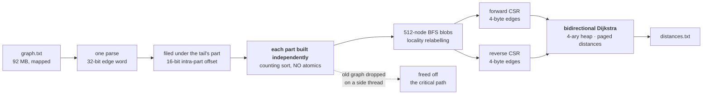

# 🅳 Track D — Traverse

**1.74 M nodes · 5 M edges · 2,000 exact shortest paths. Preprocessing is inside the timed window.**

```
TIME 169.86 ms    MEMORY 70.57 MB    SOURCE 536 lines    BOARD 68.589
reference 72.69 s — roughly 430× faster
```



---

> [!NOTE]
> **Construction is 66% of this track and the search only 33%** — measured, not assumed. `renumber` alone is 24%. That is why four separate search-side experiments all lost money here.

## How it works

1. **One parse.** `graph.txt` is mapped and cut into one line-aligned range per thread. Each edge is filed under the part of the node range its tail falls in — parts of 16,384 nodes, so **a tail's offset inside its part needs only 16 bits.**
2. **An edge is a single 32-bit word.** The neighbour is in the low bits, the weight above it. **A weight too large for the field is stored as all-ones with its value on a side list, so weights up to 2³²−1 stay exact.**
3. **Each part is built on its own** — out-degrees counted and edges placed inside a 64 KB counter array — so **the adjacency build takes no atomics at all** and few cache misses.
4. **Locality relabelling.** The ids arrive as a random permutation, so the graph is cut into **512-node blobs grown breadth-first**; the graph is copied into that numbering and then reversed. Consecutive new ids end up physically close.
5. **Both directions get their own CSR** — grouped by tail for the search from `s`, by head for the search from `t` — so either direction is one contiguous slice per node.
6. **Bidirectional Dijkstra with a 4-ary heap.** Four children per node means **four children share one cache line**, and the heap only ever holds the live frontier.
7. **Distances live in pages handed out on first touch** and returned after each query, so **a thread's memory follows its largest search** rather than the whole graph.
8. **The old graph, the edge store and the id map are dropped on a side thread** while the reverse graph is being built — the free costs nothing on the critical path.

## What makes it fast

| Technique | Axis |
|---|---|
| 4-byte packed edge word | memory, time |
| 16-bit intra-part offsets | memory |
| Chunked arena filing instead of per-part vectors | time, memory |
| Per-part build with no atomics | time |
| BFS locality relabelling | time |
| 4-ary heap, one cache line per four children | time |
| Paged, self-sizing distance store | memory |
| Side-thread teardown | time |
| Prefetch ladders (offset 8 ahead, edges 4 ahead) | time |

## Correctness

- `s == t` is `0`; a target with no in-edge is `-1` immediately.
- **Distances are unique**, so thread order can never change the output.
- The tiny hostile oracle covers zero weights, parallel and duplicate edges, self-loops, isolated vertices, unreachable targets and 64-bit distance sums.
- **Verified on three corpora**, including the official sample, against a pinned `distances.txt.sha256`.

## Build and run

```sh
sh build.sh                                        # rustc only — no cargo, no network
SD_DATA_DIR=/data SD_OUT_DIR=/out ./run            # or the container path in the top-level README
```

## Honest limits

The query queue's pool is emptied between queries but **its capacity is retained, so it holds every pushed entry including the stale ones** — where the heap it replaced freed on pop. That is the memory that keeps this track at 68.589 while its time is the best it has recorded. The fix is a free list or a compaction, and it is the clearest remaining win here.

---

<p align="center"><sub>
<b>Speed Demon 2026</b> · <a href="../README.md">README</a> ·
<a href="PERF.md">this track's measured ledger</a> ·
<a href="../docs/TECHNIQUES.md">Techniques</a> ·
<a href="../docs/MEASUREMENT.md">Measurement</a><br/>
<a href="../track-a/README.md">🅰 Ingest</a> ·
<a href="../track-b/README.md">🅱 Index</a> ·
<a href="../track-c/README.md">🅲 Join</a>
</sub></p>